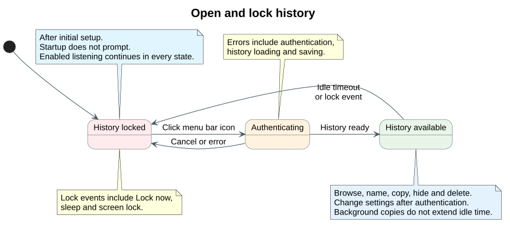
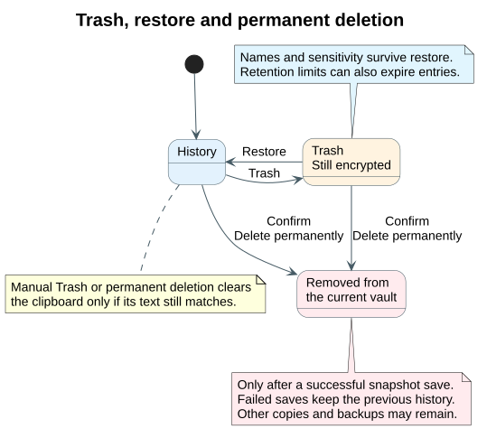
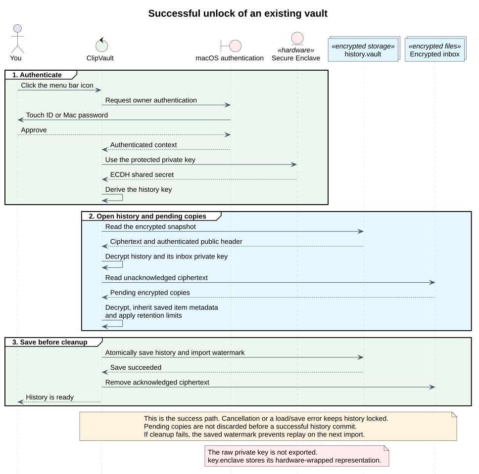

# Workflows and security

[Quick start and controls](README.md)

## Open and lock history



## Trash and permanent deletion



## What is stored

Files live in `~/Library/Application Support/ClipVault/`.

| Data | Protection |
| --- | --- |
| Values, names, sensitivity, timestamps, Trash and settings | Encrypted inside `history.vault`. |
| Pending copies in `inbox/` | Encrypted with a public key. The locked collector cannot decrypt them. |
| Inbox decryption key | Stored only inside the encrypted history. |
| `key.enclave` | Hardware-wrapped Secure Enclave key representation, peer public key and salt. No raw history key. |
| Capture preferences, public key and import watermark | Readable, authenticated header of `history.vault`. |
| Inbox filenames, sizes, timestamps and sequence counter | Readable filesystem metadata. |

History uses AES-256-GCM. P-256 key agreement and HKDF-SHA256 derive encryption keys. There are no network requests or cloud sync.

## Unlock and import



Cancellation and load/save errors leave history locked. A failed write preserves the previous snapshot. A saved import watermark prevents old pending copies from replaying after a crash.

## Limits and defaults

| Setting or limit | Default | Range or behavior |
| --- | --- | --- |
| Auto-lock | 60 seconds | 5 seconds–24 hours. Only activity inside ClipVault extends it. |
| Expiry of text copied from history | 30 seconds | 5–3,600 seconds. Newer clipboard content is preserved. Lock clears ClipVault’s unchanged copy. |
| History size, including Trash | 500 items | 1–5,000 items. |
| Retention | 30 days | 1–365 days. |
| Private-content markers | Skipped | Disable the skip filter to capture them. |
| Text per copy | Up to 1 MiB | Images and files are not captured. |
| Encrypted snapshot | 60 MiB serialized content | Oldest entries expire to fit, including Trash. Strings are not truncated. |
| Pending inbox | 64 MiB | Reaching the byte ceiling pauses capture until space is available. |
| Clipboard polling | Every 0.5 seconds | Very rapid copies can be missed. The Mac cannot poll while asleep. |

Count and age limits apply on capture, unlock and settings changes. Existing encrypted history can be pruned only after authentication. App exclusions use the frontmost application when a change is observed.

Names and sensitivity survive restart and Trash/restore. Identical values share sensitivity; names remain per item. Later copies inherit retained names and sensitivity. Hidden values are searchable by name, not their text, until temporarily shown.

## Recovery boundaries

| Situation | What to expect |
| --- | --- |
| Backup | Back up the entire ClipVault folder, including pending inbox files. Recovery still requires the original Mac and its Secure Enclave. |
| Mac reset, replacement or lost key envelope | History may be unrecoverable. There is no recovery password. |
| Permanent deletion | Backups, SSD snapshots, swap and other clipboard managers may retain copies. |
| Lock | Session keys and decrypted entries are released. Swift and macOS cannot guarantee every prior allocation is overwritten in RAM or swap. |
| Older vault format | One authenticated unlock creates the inbox key and migrates atomically, preserving the existing history key. |

<details>
<summary>Implementation, tests and diagram sources</summary>

| Responsibility | Source |
| --- | --- |
| Menu bar, authentication trigger and popup lifecycle | [main.swift](Sources/ClipVault/main.swift) |
| Inline names, sensitive controls and countdown display | [HistoryView.swift](Sources/ClipVault/HistoryView.swift) |
| Capture, sessions, reveals and item mutations | [ClipboardController.swift](Sources/ClipVaultCore/ClipboardController.swift) |
| Native authentication and Secure Enclave agreement | [Authentication.swift](Sources/ClipVaultCore/Authentication.swift) |
| Schema, retention and atomic encrypted snapshots | [Vault.swift](Sources/ClipVaultCore/Vault.swift) |
| Encrypted pending copies and acknowledgement | [EncryptedCaptureInbox.swift](Sources/ClipVaultCore/EncryptedCaptureInbox.swift) |

Run `bash scripts/test.sh` for deterministic checks with synthetic keys and a named test pasteboard. `swift scripts/check-enclave.swift` verifies unauthenticated private operations are blocked. Successful owner authentication and clipboard permission require a check in the installed app.

The Secure Enclave approach works with the local ad-hoc build. It replaces the data-protection Keychain approach, which returned missing-entitlement error `-34018` on this Mac.

All [PlantUML sources and SVG previews](docs/diagrams) are committed. After editing a `.puml`, render its matching SVG locally with PlantUML 1.2026.6.

```sh
java -Djava.awt.headless=true -jar /path/to/plantuml.jar -tsvg docs/diagrams/*.puml
```

Apple references: [Secure Enclave](https://developer.apple.com/documentation/security/protecting-keys-with-the-secure-enclave), [key agreement](https://developer.apple.com/documentation/cryptokit/secureenclave/p256/keyagreement/privatekey), [clipboard permissions](https://developer.apple.com/documentation/appkit/nspasteboard/accessbehavior-9k4t4).

</details>
