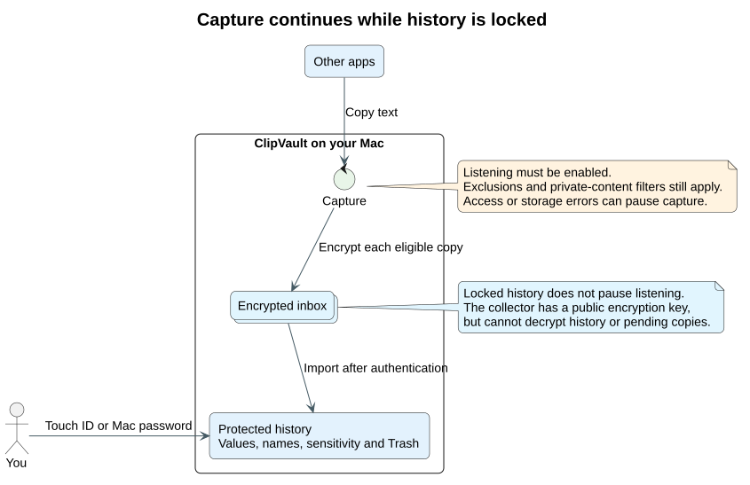
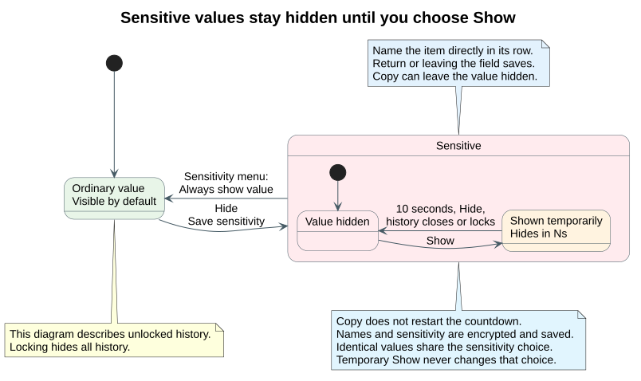

# ClipVault

A native macOS menu bar clipboard history for sensitive text. After initial setup, click the clipboard icon in the menu bar to authenticate directly and open History or Trash. Use Touch ID or your Mac login password. Clipboard text and history entry metadata are encrypted locally. Locking protects history access while enabled listening continues.



[Edit this diagram](docs/diagrams/capture.puml).

## Requirements and build

macOS 13 or later, a Mac with a Secure Enclave (Apple silicon or an Intel Mac with a T2 chip), a Mac login password, and Xcode Command Line Tools with Swift 6 or later.

```sh
bash scripts/test.sh
bash scripts/build-app.sh
open dist/ClipVault.app
```

Drag `dist/ClipVault.app` into Applications to keep it. This local build is ad-hoc signed. It is not notarized or prepared for distribution to other Macs.

## First use

1. Open ClipVault. Its clipboard icon appears in the menu bar, with no Dock icon.
2. Click **Create encrypted vault**. Approve the native macOS authentication prompt.
3. Click **Start listening**. Capture is off until you choose to enable it.
4. Copy text in another app. ClipVault captures new clipboard changes even while its history is locked. Existing clipboard contents at app startup are skipped. New copies collected while locked appear after you authenticate.
5. Values are visible by default while unlocked. Click **Hide** to save an item as sensitive, and enter a name directly in its **Item name** field to identify it without showing its value. **Copy** works while a value is hidden. **Trash** is reversible; the crossed-out trash icon permanently deletes an item after confirmation.
6. Open the gear button to change settings. Save the changes to apply them.

Recent macOS versions may request permission to read the clipboard. Allow ClipVault in the system clipboard privacy controls if you want it to listen. ClipVault does not require Accessibility permission.


[Edit this diagram](docs/diagrams/unlock.puml).

## Sensitive items

Type directly in an item’s **Item name** field. Press Return or leave the field to save it. Clicking outside history dismisses the popup and finishes the current name edit.

**Hide** saves an item as sensitive. Its name remains visible, and **Copy** copies its value without showing it. **Show** reveals a sensitive value for 10 seconds. A **Hides in Ns** countdown shows the remaining time, then the value hides again. Closing history or locking the vault also clears temporary reveals. Showing a value never changes its saved sensitivity. Use the item’s sensitivity menu and **Always show value** to make it visible by default again.

Names and sensitivity are encrypted with each entry and survive lock, restart, and Trash/restore. Identical copied values share the saved sensitivity choice, including copies in Trash; names remain per item. A later copy of the same value inherits its saved name and sensitivity from retained matching history, including Trash. Hidden values can be found by name; their text is excluded from search until temporarily shown. Names are optional, trimmed, and limited to 120 characters on one line.

For an existing vault, clicking the menu bar icon while locked starts native Touch ID or Mac-password authentication directly. The app reopens history after successful authentication. Starting the app or collecting a copy in the background never triggers authentication. The **Unlock vault** button remains available as a fallback. Initial vault creation still requires an explicit choice.



[Edit this diagram](docs/diagrams/sensitive-items.puml).

## Settings

- Auto-lock after 5 seconds through 24 hours, entered in seconds or minutes. The default is 60 seconds. Only interaction within ClipVault extends the inactivity deadline. Clipboard capture in another app does not.
- Clear text copied from history after 5–3,600 seconds, defaulting to 30 seconds. It clears only if the clipboard has not changed since ClipVault wrote it. Locking also clears text that ClipVault still owns.
- Enable or pause listening. An enabled listener continues while history is locked, including after app restart. Settings changes require authentication.
- Skip private and temporary clipboard content. Enabled by default to respect password manager markers. Disable this only if you deliberately want that content stored.
- Exclude applications by bundle ID, one per line. This uses the frontmost application when the clipboard change is observed.
- Keep at most 1–5,000 items, including Trash, defaulting to 500. Permanently expire entries after 1–365 days, defaulting to 30. Limits apply on capture, unlock, and settings changes. Reducing limits can remove old entries from the current vault. Authenticated import also removes the oldest whole entries, including Trash, when necessary to keep the serialized snapshot within 60 MiB; individual copied strings are never truncated.

## Encryption and authentication

History is one AES-256-GCM authenticated encrypted snapshot. It includes the text, names, saved sensitivity, timestamps, deletion state, settings, and an inbox decryption private key. Temporary reveal deadlines are never saved. The snapshot has an authenticated public header containing the inbox encryption public key, capture preferences, and imported sequence watermark. Capture preferences include excluded app bundle IDs and can be read without unlocking; copied text and private keys cannot. Random nonces prevent identical snapshots from producing identical ciphertext. Writes use a private temporary encrypted file and an atomic rename. A failed save keeps the previously committed history, and a capture failure pauses listening with an error.

An access-controlled P-256 private key stays inside this Mac's Secure Enclave. Every unlock derives the history key from an ECDH secret and HKDF-SHA256. The Secure Enclave enforces user presence for private key operations, using Touch ID or the Mac login password through Apple's LocalAuthentication framework. The first setup authenticates the owner before creating the key. A temporary software peer private key exists only during initial setup and is discarded. No raw history key or peer private key is saved.

Files live in `~/Library/Application Support/ClipVault/`. `history.vault` is the encrypted history with its public capture header. `inbox/` contains pending encrypted copies and a monotonic sequence counter. Inbox filenames, sizes, file modification times, and the counter expose capture activity but not copied text. `key.enclave` contains the hardware-wrapped Secure Enclave key representation, peer public key, and HKDF salt. These files cannot unlock the vault without this Mac's Secure Enclave and user authentication. The directory is mode 0700 and files are mode 0600. There are no network requests, cloud sync, analytics, or plaintext exports.

New clipboard copies always enter a separate encrypted inbox first. Each copy uses a fresh ephemeral P-256 key, ECDH, HKDF-SHA256, and AES-256-GCM. The locked collector has only the recipient public key. It cannot decrypt the inbox or read existing history. After authentication, the app imports pending copies and commits an imported sequence watermark before removing acknowledged ciphertext. This prevents duplicate or deleted items from reappearing after a crash.

The app releases its session key, inbox decryption private key, and decrypted entries on lock. Enabled listening continues without an authentication prompt. An older vault needs one successful unlock to create its inbox key and migrate its format; its history encryption key is preserved. It also locks on sleep, display sleep, screen lock, and user-session resignation. Swift and macOS manage memory; ClipVault cannot guarantee that every previous plaintext allocation has been overwritten in RAM or swap.

## Limits and recovery

This version captures text only, up to 1 MiB per entry, with a 60 MiB serialized-history ceiling. It polls for changes every half second, so very rapid copies can be missed. Consecutive identical active items are deduplicated on authenticated import. The pending encrypted inbox is bounded by the configured item limit and retention period, with a 64 MiB storage ceiling. Reaching the byte ceiling pauses capture with an error until pending copies can be imported. History retention is applied on authenticated import; older encrypted snapshot entries cannot be pruned while locked. The Mac cannot poll while asleep; listening resumes on wake with history still locked. Images, files, launch at login, custom app passwords, and multi-device recovery are outside this version.

Soft deletion keeps the item encrypted in Trash. Permanent deletion removes it from the latest encrypted snapshot. It does **not** promise physical erasure from SSDs, APFS snapshots, Time Machine, swap, other applications, or other clipboard managers. Deleting an item clears the live clipboard only if it still contains the same text. Encryption protects stored history, not text currently on the system clipboard or an unlocked session.


[Edit this diagram](docs/diagrams/deletion.puml).

The key is bound to this Mac. Copying the files to another Mac does not recover the history. Losing `key.enclave`, replacing the Secure Enclave, or erasing the Mac can make history unrecoverable. No recovery password is provided. Back up the entire ClipVault folder if you want same-Mac recovery, including pending inbox records; backups may retain permanently deleted entries. Missing keys and corrupted vaults fail closed and are never silently replaced.

## Verification

`bash scripts/test.sh` uses temporary encrypted vaults, synthetic keys, and a named test pasteboard. It does not read or change the general clipboard or bypass authentication in the production app. Tests also cover saved names and sensitivity, temporary reveal expiry, hidden copy, legacy entry and pending-record decoding, metadata validation, and duplicate-copy inheritance. Tests cover encrypted capture while locked, idle expiry, restart before unlock, canceled authentication, locked exclusions/pause, inbox encryption and tampering, crash-safe import, legacy migration, authenticated encryption, deletion, clipboard expiry, limits, and failed writes.

Run `swift scripts/check-enclave.swift` for a noninteractive hardware check. It creates only an ephemeral protected key, checks reconstruction, and confirms that a private operation is blocked without user presence. Real Touch ID/password approval and system clipboard permission still need to be exercised in the installed app by the Mac owner.

Apple documents [Secure Enclave key protection](https://developer.apple.com/documentation/security/protecting-keys-with-the-secure-enclave), [Secure Enclave P-256 key agreement](https://developer.apple.com/documentation/cryptokit/secureenclave/p256/keyagreement/privatekey), and [pasteboard permission behavior](https://developer.apple.com/documentation/appkit/nspasteboard/accessbehavior-9k4t4).
